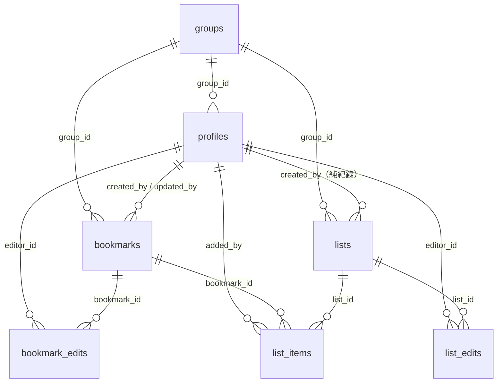

# 協作三功能設計筆記

分支：`feat/collab-history-lists`　migration：`supabase/migrations/2026-09-26-collab-history-lists.sql`

## ROI 4 題（動工前置檢查）

**① 預期效果有多大？** 家人共用一份美食景點清單，目前 477 筆收藏全部顯示「未知是誰存的」、
改一個店名也看不出是誰改的、想把「這次去花蓮要吃的」挑出來也做不到，只能在近 500 筆裡滑手機找。
這三個功能是每次開網頁都會用到的日常動作（看清單、編輯、分類），不是年用幾次的邊緣功能。

**② 替代方案能 cover 多少？** 沒有替代方案能做到「誰做的」——LINE 群組本身看得到誰傳了連結，
但一旦進了資料庫就全部攤平成同一個「鴨嘴獸」bot 帳號，源頭資訊在 webhook 那一關就已經丟失，
不是網頁端事後能補的。清單/分類目前完全沒有替代品（現有的城市/類型篩選是即時篩選，
不是可以手動策展、跨次瀏覽都留著的清單）。cover 率趨近 0%，不是紅旗。

**③ 新增幾個故障維度？** 三個：(a) 新表的 RLS/RPC 權限設計要跟現有 anon-key 全開模型一致，
設計錯了會變成資安洞；(b) LINE webhook 多一次 LINE Profile API 呼叫，多一個外部依賴，失敗需
fallback 不能擋住原本的收藏流程；(c) trigger 自動寫編輯歷史，寫錯條件可能洗版或漏記。
三個都是「新增即有」的必要故障面，且都有明確的失敗降級路徑（見下方各段），不是無底洞。

**④ 語境可移植性？** 這是自家/親友用的私有工具，不是要服務陌生使用者，資安要求本來就
低於商業產品；「選名字、不做帳密」在這個場景下（成員 <10 人、彼此認識、LINE 群組本身就是
信任邊界）是合理權衡，不是抄一個不對等場景的方案。

**結論：4 題無紅旗，動工。**

## 資料模型

### 身分模型（重要，先讀這段）

**討論過程中變過三次，這是最終定案（2026-09-26）：**

1. 一開始想做「選名字或新增名字，存 localStorage」。
2. 後來加了「清單可協作」的 owner／開關設計。
3. 最後拍板：**身分＝LINE 名字**。profiles 完全由 LINE webhook 依 LINE userId
   建立/更新（`get_or_create_profile_by_line`），LINE 暱稱改了，下次傳訊息就跟著更新。
   **網頁端不提供「新增名字」**，「選名字」畫面只能從 `list_group_members` 回傳的
   既有名單挑一個；名單是空的或找不到自己，畫面提示「先在 LINE 群組傳一則訊息就會出現」。
   選好的身分存在 `localStorage`（`tb_identity`），之後可以隨時切換成名單上的別人。
   同一批討論也拍板拿掉「清單協作開關／owner 限制」——lists 就是分類，不是個人地盤，
   同群組任何人都能建立、改名、加入/移出項目。

**這是君子協定，不是登入系統。** 選名字不需要密碼、不需要驗證，任何人都能選任何一個
LINE 群組成員的名字冒充他。資料庫層級（RLS/RPC）沒有辦法、也沒有嘗試去驗證「你選的
名字真的是你」——`created_by`／`updated_by`／`editor_id`／`added_by` 全部只是「畫面上
顯示是誰做的」的紀錄欄位，不是權限邊界。這個信任等級跟專案現有的 anon key 全開模型
（任何拿得到 anon key 的人本來就能讀寫刪全部資料）一致，沒有讓整體資安變差，只是把
「誰做的」這件事從「完全不記錄」升級成「記錄但不驗證」。

### 表結構

| 表 | 新增/沿用 | 重點欄位 |
|---|---|---|
| `profiles` | 沿用，加欄位 | `+ line_user_id text unique(partial)`（LINE userId 對應真人） |
| `bookmarks` | 沿用，加欄位 | `+ updated_by uuid → profiles`（最後編輯者，nullable） |
| `bookmark_edits` | 新表 | `bookmark_id, editor_id, field, old_value, new_value, created_at` |
| `lists` | 新表 | `id, group_id, created_by（純紀錄）, name, created_at` |
| `list_items` | 新表 | `list_id, bookmark_id, added_by, added_at`，PK `(list_id, bookmark_id)` 多對多 |
| `list_edits` | 新表 | `list_id, editor_id, action[add/remove/rename], bookmark_id?, detail?, created_at` |

### 為什麼「誰上傳」不用改 RPC 簽名

實測（唯讀連線 `SUPABASE_DB_URL` 查 `pg_get_functiondef`）發現 `insert_bookmark_from_bot`
早就把 `p_created_by` 直接塞進 INSERT，完全沒有寫死——webhook 端現在傳的是常數
`LINE_DEFAULT_USER_ID`（線上唯一一筆 profile，顯示名稱「鴨嘴獸」，也就是 477 筆收藏
全部歸給同一個 bot 帳號的真因）。只要 webhook 端改傳「這個 LINE 使用者對應的 profile id」
就好，函式本體不用動。

### 為什麼 profiles 走 SECURITY DEFINER RPC 而不是加 RLS 政策

`profiles` 目前的 4 條 RLS 政策是舊的 email-OTP 認證殘骸（`auth.uid()` 為主，
`AuthForm.tsx`／`SetupProfile.tsx` 兩支元件目前完全沒有被任何頁面引用，是半成品死碼），
anon key 讀不到也寫不到 `profiles`。紅線要求「不改 RLS 為更寬鬆」，所以本次**完全沒有動
`profiles` 既有的 4 條政策**，改用 `list_group_members`／`get_or_create_profile_by_line`
兩支 `SECURITY DEFINER` 函式當唯一存取窗口——這正是本專案 `insert_bookmark_from_bot`
已經在用的既有模式（繞過 RLS 是函式 owner 的權限，不是新政策），不是新發明的繞法。

### 為什麼編輯歷史用 trigger、清單歷史用 RPC 兩種不同機制

- **`bookmark_edits`**：由 `bookmarks` 表的 `AFTER UPDATE` trigger
  （`log_bookmark_edit()`）自動比對 `OLD`/`NEW` 欄位差異寫入。這裡適合用 trigger，
  因為「誰改的」已經在 `NEW.updated_by` 欄位裡（呼叫端 UPDATE 時一起帶），
  trigger 讀得到，不需要額外傳參數。**`NEW.updated_by` 為 null 時完全不記錄**——
  這是刻意設計，`tools/enrich.sh`（Ollama 自動辨識排程，每 2 分鐘跑一次直接用
  anon key UPDATE）不會也不應該帶 `updated_by`，這樣它的自動補值不會洗版編輯歷史。
- **`list_edits`**：由 `list_add_item`／`list_remove_item`／`list_rename` 三支
  `SECURITY DEFINER` RPC 在函式內部直接寫入，跟主要異動包在同一顆 Postgres 交易裡。
  這裡**不能**用 trigger，因為「移出」「改名」的「是誰做的」只有呼叫端知道——
  trigger 拿不到呼叫者身份，除非額外用 session variable 傳遞，那就是又新增一套機制，
  跟「擇一，不要兩套」的要求衝突。改用 RPC 統一路徑後，四個原始需求動作
  （新增/移除/改名/切換協作）目前只剩三個（`toggle` 隨協作開關一起被拿掉），
  全部走同一種「異動 + 記錄同一顆交易」的寫法，沒有第二套機制。

### 討論中途追加的三個畫面（2026-09-26 同一批需求，非另開工）

- **依上傳者篩選**：篩選列多一個「全部（依上傳者）」下拉，選項來自 `list_group_members`，
  每個名字後面附目前筆數。純前端 `Array.filter`，不動 schema，可以跟縣市/分類篩選疊加。
  選到某個人時，篩選列下方會多列出「這個人建立的清單」；選到的剛好是自己時，
  同一個地方會多一個「+ 建立你的新清單」快速輸入框（不用切去清單分頁）。
- **最近動態**：頁首「🕘 最近動態」按鈕展開一個可捲動面板，混合三種來源依時間倒序：
  `bookmarks`（新增，用 `created_at`/`created_by`）、`bookmark_edits`（編輯欄位，各抓最近 50 筆）、
  `list_edits`（清單異動，抓最近 50 筆）。點一筆：跟收藏有關的會切到「收藏」分頁、
  捲動並短暫框起對應卡片；跟清單有關的會切到「清單」分頁（沒有做自動展開特定清單，
  避免為了這個又要跨元件同步一個「目前該展開誰」的狀態——時間有限，先做「跳對分頁」，
  使用者自己點開通常只有 1-2 個清單，成本很低）。
- **清單分享連結**：每個清單卡片有「🔗 分享連結」按鈕，複製 `/?list=<id>`。打開這個網址
  會跳過收藏/清單分頁，只顯示那一個清單（仍然要先選過名字才看得到內容，理由見上面
  「身分模型」——分享連結不是繞過選名字的後門，只是省去「切分頁+找是哪一個清單」）。
  清單本身沒有權限限制（跟其他清單一樣，同群組任何人都能加入/移出/改名），
  分享連結不是「唯讀連結」，是「快速抵達連結」。

## 上線步驟（給網站擁有者）

1. 打開 Supabase Dashboard → 選對的專案 → 左邊選單 **SQL Editor** → New query。
2. 整份貼上 `supabase/migrations/2026-09-26-collab-history-lists.sql`，按 **Run**。
   （冪等，重複執行也不會壞——用的是 `add column if not exists` / `create table if not exists` /
   `create or replace function`。）
3. 貼完後可以照檔案最下面「驗證」那幾行 SQL 各自跑一次，確認新欄位/新表/新函式都出現。
4. 回來跟我說一聲（或直接在 GitHub 上看 `feat/collab-history-lists` 這個分支），
   我就把它合併到 `main`、跑 `vercel build --prod && vercel deploy --prebuilt --prod --yes` 部署上線。
5. 上線後**舊資料不用回填**：舊的 477 筆收藏 `updated_by` 是 null（不會顯示「最後編輯」那行，
   只顯示「由 鴨嘴獸 上傳」），LINE 那邊之後新收藏才會開始正確顯示真人名字。

## 已知限制（codex review 抓到，記錄不是忽略）

- **`resolveUploaderProfileId` 疊加在 webhook 回覆前面，會拉長 LINE reply 的總時間**
  （LINE Profile API 呼叫 + 5 秒 timeout + 一次 RPC，疊在原本就有的 `fetchOgMeta` 之上）。
  真的要做無延遲版本得改成「先用 `DEFAULT_USER_ID` 建立收藏＋立刻回覆，事後用 Vercel
  `waitUntil` 背景把 `created_by` 更新成真人」，但那是另一次改動（要處理『回覆先發生、
  DB 事後更新』這段時間差的邊界情況），這次先不做——5 秒 timeout 在 LINE reply token
  的容許時間內，先求正確、不求最快。之後如果實測真的常常 timeout 再回來做。

## 沒做的（明確排除，避免之後以為漏做）

- 即時同步（多人同時開網頁看到彼此的即時變化）——沒做，畫面資料是進站當下抓的快照。
- 清單投票、排序、備註——沒做，`lists`/`list_items` 只有「加入/移出/改名/刪除」四個動作。
- 清單協作開關（早期討論版本的 `is_collaborative`）——拍板拿掉了，lists 現在就是分類，
  同群組任何人都能編輯任何清單，沒有 owner 限制。
- 網頁端自由新增名字——拍板拿掉了，身分完全跟著 LINE 走。
